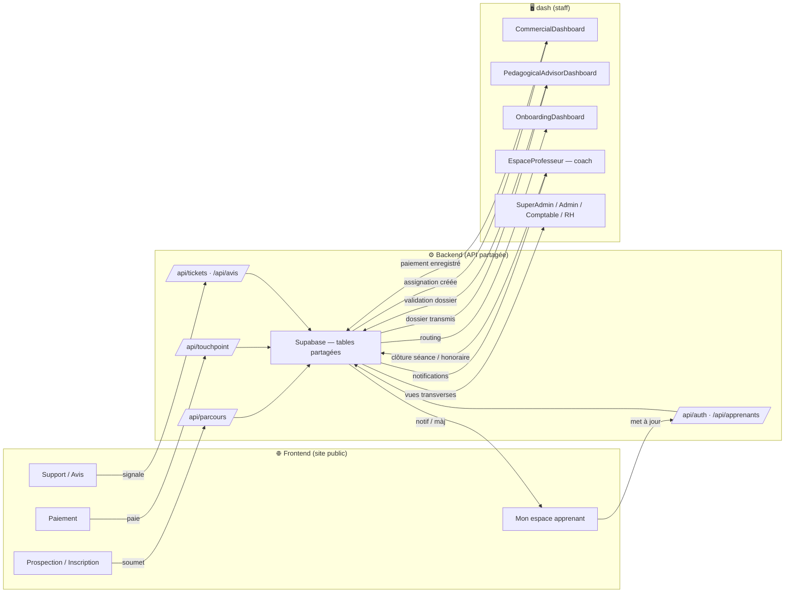

# Workflows Frontend ↔ Dash (via Backend)

Schéma des 28 workflows reliant le site public (**Frontend**) aux dashboards internes (**dash**) via l'API partagée (**Backend**). Généré à partir d'un audit du code le 26/08/2026.

## Vue d'ensemble

## Détail par catégorie (28 workflows)

### 1. Prospection / Inscription
| # | Workflow | Déclencheur Frontend | Effet côté dash | Routes Backend |
|---|---|---|---|---|
| 1 | Test de niveau gratuit | `FreeLevelTest.jsx` | Commercial → "Tests reçus" | `/api/level-test/*` |
| 2 | Choix de parcours (particulier/enfant/entreprise/en ligne) | `ParcoursTunnel.jsx`, `EnfantParcoursModal.jsx`, `EntrepriseParcoursModal.jsx`, `CentresEnLigneModal.jsx` | Commercial → "Prospects parcours", puis PA | `/api/parcours/assignation`, `/transmettre-pa` |
| 3 | Inscription adulte / coaching privé | `ParcoursParticulier.jsx` | Commercial → "/inscriptions/all", validation PA | `/api/inscriptions/adulte/submit`, `contratsPrives.js` |
| 4 | Devis entreprise (BET for Business) | `BetForBusiness.jsx` | Commercial/Onboarding → "Prospects" B2B | `/api/entreprise/submit`, `/api/corporate/prospects` |
| 5 | Formulaire de contact | `Contact.jsx`, `MonEspace.jsx` | Commercial → "mes-clients" | `/api/contact/submit`, `/mes-clients` |
| 6 | Newsletter | Footer Frontend | Liste abonnés dash | `/api/newsletter/subscribe`, `/subscribers` |
| 7 | Code promo | `CentresEnLigneModal.jsx` | Gestion codes promo (SuperAdmin/Admin) | `/api/codes-promo/valider` |
| 8 | Sondage de satisfaction | `MonEspace.jsx` | Commercial → stats clients | `/api/sondage/*` |
| 9 | Chat prospect en direct | `ProspectChat.jsx` (Firebase) | Panel chat Commercial/Onboarding/PA | Firestore `parcours_{assignation_id}` |

### 2. Paiement
| # | Workflow | Déclencheur Frontend | Effet côté dash | Routes Backend |
|---|---|---|---|---|
| 10 | Paiement TouchPoint | `PaiementRetour.jsx` | Commercial/Comptable → paiement enregistré | `/api/touchpoint/verify`, `/confirm-redirect` |
| 11 | Relance paiement (Mon espace) | `RelancerPaiement.jsx`, `MonEspace.jsx` | Commercial/Comptable → réconciliation | `/api/paiements/mes-paiements-prospect` |
| 12 | Commande boutique | `Boutique.jsx` | Admin/SuperAdmin/EspaceApprenant → file de commandes | `/api/boutique/commandes` |
| 13 | Paiement entreprise (contrat B2B) | Portail RH entreprise | Renouvellement validé en dash | `/api/entreprise/admin/:id/paiements` |

### 3. Pédagogie / Cours
| # | Workflow | Déclencheur | Effet côté dash/Frontend | Routes Backend |
|---|---|---|---|---|
| 14 | Session live coach (début/fin) | `EspaceProfesseur.jsx` | Apprenant notifié, superviseur/commerciale notifiés | `/api/coachs/sessions-live` |
| 15 | Présences/évaluations de groupe | `EspaceProfesseur.jsx` | Apprenant + Commercial "Mes apprenants" | `groupes.js` `/presences`, `/suivi` |
| 16 | Séances/présences coaching privé | PA/assistant | Apprenant privé "Mon espace" | `seancesPrivees.js`, `presencesPrivees.js` |
| 17 | Fichiers pédagogiques partagés | Coach/dash upload | Apprenant "Mon espace" fichiers | `fichiersPrives.js`, `/api/mon-espace/fichiers` |
| 18 | Évaluation/classement coach | dash | Rapports transmis, visible apprenant/parent | `coachs.js` `/classement`, `/rapports-transmis` |
| 19 | Inscriptions e-learning en masse | dash (bulk) | Comptes utilisables sur Frontend/bet-elearning | `inscriptionsElearning.js` |

### 4. Compte / Profil
| # | Workflow | Déclencheur Frontend | Effet côté dash | Routes Backend |
|---|---|---|---|---|
| 20 | Inscription/connexion partagée | `MonEspace.jsx`, `ParcoursModal.jsx`, `CourseDetail.jsx` | Compte utilisable dans `EspaceApprenant`/`ParentDashboard` | `authRoutes.js` |
| 21 | Mise à jour profil/photo | `MonEspace.jsx` | Commercial "Mes apprenants" (avatar sync) | `/api/upload/avatar`, `/api/auth/profile` |
| 22 | Mot de passe oublié | `MonEspace.jsx`/`Connexion.jsx` | Réinitialisable par admin | `/api/auth/forgot-password` |
| 23 | Création accès enfant/parent | Parcours enfant | `ParentDashboard.jsx` | `apprenants.js` `/creer-acces-parent` |

### 5. Support / Témoignages / Marketing
| # | Workflow | Déclencheur Frontend | Effet côté dash | Routes Backend |
|---|---|---|---|---|
| 24 | Témoignage apprenant | `MonEspace.jsx` | Modération SuperAdmin → publication publique | `/api/upload/temoignage`, `/api/temoignages/soumettre` |
| 25 | Avis sur formation | `CourseDetail.jsx` | Modération dash → publication | `/api/avis`, `/api/avis/publics` |
| 26 | Ticket / plainte support | `MonEspace.jsx` | CustomerCare/Admin → file de tickets | `/api/tickets/moi`, `/api/tickets` |
| 27 | Capture de leads | Lead forms Frontend | Commercial → nurturing marketing | `leads.js` |
| 28 | Simulateur de formation | Outils Frontend/dash | Résultat porté dans l'assignation parcours | `simulateur.js` |

---
*Document généré automatiquement à partir d'un audit du code — à mettre à jour si de nouveaux workflows sont ajoutés.*
